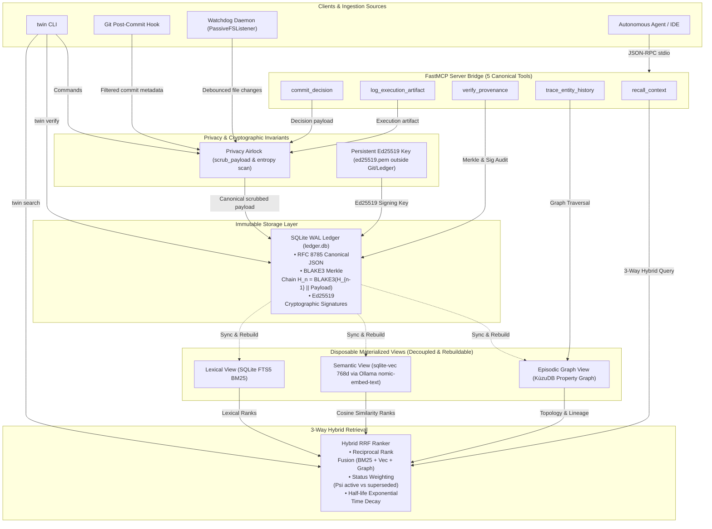

# Project Aethelgard v1.0.0

Sovereign Cognitive Twin & Cryptographic Provenance Engine.

What is the significance?

Foundation models are going to get cheaper, better, and more interchangeable. They commoditize. What doesn't commoditize is your context: the decisions you made, why you made them, what you rejected, what you tried, what actually happened when you ran it.

Right now that context is scattered and fragile. It's in chat histories that reset, in markdown notes you forget to update, in Git commits with no reason attached, in your head. A new model starts from zero, guesses at your past, and hallucinates it confidently.

Aethelgard is meant to fix that by keeping one local, verifiable record, and letting any model plug into it.

How that works, in purpose terms:

Ledger: a diary that can't be silently edited. Every decision, note, commit, and file change gets hashed to the previous one, so if someone edits the middle, verify fails. Now signed with your persistent Ed25519 key, so new events are signed, not just hashed.

Airlock: secrets are scrubbed before anything is stored, so your memory doesn't become a leak.
Views: the same ledger is indexed three ways, so recall actually works. FTS5 finds exact words, sqlite-vec with Ollama finds meaning even if you phrase it differently, and KùzuDB finds relationships and timelines, like what superseded what, and what involved which project.

RRF: those three are combined, with old superseded decisions penalized, so you get the current answer, not a dead one.

MCP: that's the plug. Antigravity today, any other agent tomorrow, can call recall_context, commit_decision, trace_entity_history, log_execution_artifact, and verify_provenance, all from the same local store. You're not locked to one vendor's memory.

Hook and daemon: passive capture, so you don't have to remember to log. A git commit becomes a git_commit event automatically, a file change becomes a file_change event, without you writing a note.


A concrete example:

In 2026 you decide to use persistent signing over unsigned events, and you reject plain markdown notes. In 2029 you ask a totally different model, "why do we sign events?" It shouldn't guess. It should recall that exact decision, show you the rejected alternatives, show you that ADR-003 superseded the earlier unsigned approach, and show you verify still passes for that chain.

That's the compounding part. Every year you use it, the record gets more useful, not more stale, and it stays yours, local, offline-first, not in someone else's cloud, not lost when a platform changes pricing or shuts down.

What it is not, honestly:

It's tamper-evident, not tamper-proof. If someone has both your ledger and your key on the same machine, they could rewrite and re-sign. It doesn't prove who you are to the outside world, and its timestamps are local, not trusted time. That's why the backups matter, and why verify is about detecting middle edits, not claiming absolute proof.

In short: models will come and go. Aethelgard is the part that stays, remembers, and can prove what it remembers.


Imagine you have a magic notebook.

1. You write in it, and no one can secretly change it.
Every time you make a choice, like "we will sign our pages from now on," you write it on a new page. That page gets glued to the page before it with a special secret sticker code. If someone tries to change a page in the middle, the sticker codes won't match anymore, and you can tell.

You also stamp each new page with your own secret stamp, which you keep in a different drawer, not in the notebook. So people can check, "yep, that's Nick's stamp."

Old pages never get torn out. If you change your mind, you just write a new page that says "this replaces that old page." The old page stays, but it gets a little less important.

2. Little helpers write in it for you.
You don't have to remember to write everything down. When you save your code, a little helper whispers, "he just saved code," and writes it down. When you change a file, another helper whispers, "he just changed that file," and writes it down.

3. When you ask a question, it finds the right pages three ways.
Say you ask, "why do we sign things?"

First, it looks for the exact words.
Second, it looks for the meaning, even if you said it in different words, like "stamps" instead of "signing."
Third, it looks at friends. Like, this choice is friends with that project, and that project is friends with this other choice.

Then it puts those three lists together and gives you the best pages, with the newest, not-crossed-out ones first.

4. Robot friends can talk to the notebook.
Your robot friend in Antigravity doesn't have to guess what you did last week. It can just ask the notebook, "hey, what did Nick decide about signing?" and the notebook answers with the real pages, not a made-up story.

And the notebook lives in your house, on your computer, not in someone else's cloud. So it's yours, even if the robot friend changes later.

That's it. A notebook that remembers, proves it didn't get changed, and can answer questions about what you did and why.

---

## Architecture



### Architectural Subsystems

1. **Model Context Protocol (MCP) Bridge**:
   - Exposes 5 canonical tools over standard I/O (`stdio`): `recall_context`, `commit_decision`, `trace_entity_history`, `log_execution_artifact`, and `verify_provenance`.
   - Bridges autonomous IDE agents directly to Aethelgard's cognitive store.

2. **Privacy Airlock & Cryptographic Ledger**:
   - **Privacy Airlock**: Sanitizes and scrubs high-entropy tokens, API keys, private credentials, and personal information before persistence.
   - **Canonicalization**: Invariant payload formatting following RFC 8785 canonical JSON.
   - **BLAKE3 Merkle Chain**: Every record forms a continuous Merkle hash chain: $H_n = \text{BLAKE3}(H_{n-1} \parallel \text{Payload})$.
   - **Persistent Ed25519 Signatures**: Host-level signing key persisted in `~/.local/share/aethelgard/ed25519.pem` (outside Git and the database) signs every committed event.

3. **Decoupled Disposable Views**:
   - **Lexical View (SQLite FTS5)**: Fast BM25 keyword search over identifiers, code tokens, and error strings.
   - **Semantic View (sqlite-vec)**: 768-dimensional dense vector embeddings generated via Ollama (`nomic-embed-text`) with deterministic mock fallback.
   - **Episodic Graph View (KùzuDB)**: Property graph tracking architectural decisions (`Decision`), executions (`ExecutionArtifact`), and `SUPERSEDES` relationships.
   - *Disposable Invariant*: All views can be dropped and rebuilt from the immutable ledger at any time via `twin rebuild-views`.

4. **3-Way Hybrid Reciprocal Rank Fusion (RRF)**:
   - Combines lexical (BM25), semantic vector, and graph traversal rankings using Reciprocal Rank Fusion:
     $$\text{RRF}(d) = \sum_{c \in \{\text{BM25}, \text{Vec}, \text{Graph}\}} \frac{w_c}{k + r_c(d)} \cdot \Psi(d) \cdot e^{-\lambda \Delta t}$$
   - Filters superseded patterns by default ($\Psi_{\text{superseded}} = 0.0, \Psi_{\text{active}} = 1.0$) and applies configurable half-life exponential time decay ($e^{-\lambda \Delta t}$).

5. **Passive Background Ingestion**:
   - **Non-Blocking Git Hook**: Automatically captures commit hashes, messages, author identities, and file changes on `git commit`, strictly guaranteeing exit code 0 to protect commit workflow integrity.
   - **Passive Watchdog Daemon**: Monitors workspace file events with configurable debouncing, filtering out lockfiles, build artifacts, bytecode, and virtual environment directories.

---

## Open in Antigravity

1. Download the zip and extract it with your operating system (right-click, Extract, or double-click on Mac). Do not run unzip commands in a chat window, those only work in a terminal.
2. In Antigravity, choose Open Folder, then select the extracted `aethelgard` folder.
3. Open a terminal inside Antigravity (Terminal menu, New Terminal) and run the commands below from inside that folder.

## Run the tests

```bash
python3 -m venv .venv
.venv/bin/pip install blake3 cryptography pytest
PYTHONPATH=src .venv/bin/pytest -v
```

On Windows, use `.venv\Scripts\activate` instead of `.venv/bin/`, then `python -m pytest` with `PYTHONPATH=src` set in the same way for your shell.

## Use the CLI

After installing the package, or with PYTHONPATH set:

```bash
twin commit --title "Use SQLite WAL" --context "Local durability" --decision "SQLite 3 in WAL mode"
twin note "First note"
twin rebuild-views
twin verify
```

Default ledger location is `~/.local/share/aethelgard/ledger.db`. Use `--db <path>` to use a different database file.

## Layout

- `src/aethelgard/airlock.py` - Privacy Airlock & high-entropy secret scrubber
- `src/aethelgard/canonical.py` - RFC 8785 canonical JSON serializer
- `src/aethelgard/ledger.py` - SQLite WAL ledger, BLAKE3 Merkle chain, persistent Ed25519 signing
- `src/aethelgard/views.py` - Decoupled FTS5 and sqlite-vec materialized views
- `src/aethelgard/embeddings.py` - Ollama `nomic-embed-text` embeddings with deterministic fallback
- `src/aethelgard/graph.py` - KùzuDB embedded property graph
- `src/aethelgard/ranker.py` - 3-way hybrid Reciprocal Rank Fusion (RRF) engine
- `src/aethelgard/mcp.py` - FastMCP stdio bridge (5 canonical tools)
- `src/aethelgard/filters.py` - Artifact, lockfile, and virtualenv path filtering
- `src/aethelgard/git_hook.py` - Non-blocking git post-commit hook ingestion
- `src/aethelgard/listener.py` - Watchdog filesystem listener with debounce dispatch
- `src/aethelgard/daemon.py` - Passive background capture daemon
- `src/aethelgard/systemd.py` - Systemd user service unit generator
- `src/aethelgard/cli.py` - `twin` unified CLI entrypoint
- `tests/` - Comprehensive test suite (32 unit & integration tests)
